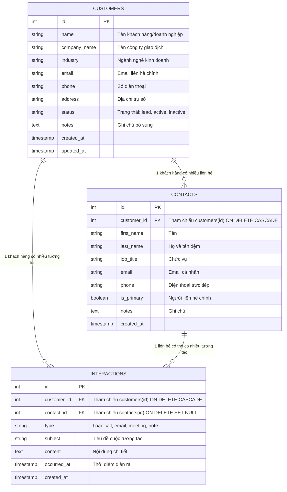

# BÁO CÁO ĐỒ ÁN MÔN HỌC
## TRIỂN KHAI VÀ QUẢN TRỊ HỆ THỐNG PHẦN MỀM

---

# ĐỀ TÀI: XÂY DỰNG VÀ TRIỂN KHAI HỆ THỐNG CRM CHĂM SÓC KHÁCH HÀNG VỚI KIẾN TRÚC MICROSERVICES TRÊN NỀN TẢNG DOCKER COMPOSE VÀ UBUNTU SERVER

```
                 BỘ GIÁO DỤC VÀ ĐÀO TẠO
               TRƯỜNG ĐẠI HỌC CÔNG NGHỆ...
              KHOA CÔNG NGHỆ THÔNG TIN

                    ═════════════════════════
                         BÁO CÁO ĐỒ ÁN
              TRIỂN KHAI & QUẢN TRỊ HỆ THỐNG PHẦN MỀM
                    ═════════════════════════

    Đề tài:     XÂY DỰNG VÀ TRIỂN KHAI HỆ THỐNG CRM CHĂM SÓC KHÁCH HÀNG
                VỚI DOCKER COMPOSE, POSTGRESQL, NG his INX, PROMETHEUS,
                GRAFANA VÀ LOKI TRÊN UBUNTU SERVER

    Sinh viên:  [HỌ VÀ TÊN SINH VIÊN]
    MSSV:       [MÃ SỐ SINH VIÊN]
    Lớp:        [TÊN LỚP SINH HOẠT]
    Giảng viên: [TÊN GIẢNG VIÊN HƯỚNG DẪN / PHỤ TRÁCH]

                    Thành phố Hồ Chí Minh — 2026
```

---

## MỤC LỤC CHI TIẾT

- **CHƯƠNG 1: TỔNG QUAN ĐỀ TÀI VÀ MỤC TIÊU**
  - 1.1. Bối cảnh và Tầm quan trọng của bài toán CRM
  - 1.2. Mục tiêu nghiên cứu và triển khai
  - 1.3. Phạm vi chức năng của hệ thống
  - 1.4. Yêu cầu phi chức năng và tiêu chí đánh giá

- **CHƯƠNG 2: THIẾT KẾ KIẾN TRÚC VÀ CƠ SỞ DỮ LIỆU**
  - 2.1. Kiến trúc tổng quan Microservices
  - 2.2. Thiết kế Cơ sở dữ liệu quan hệ PostgreSQL
  - 2.3. Ràng buộc toàn vẹn và Tối ưu hóa truy vấn (Indexes & Triggers)
  - 2.4. Dữ liệu mẫu khởi tạo (Seed Data)

- **CHƯƠNG 3: PHÁT TRIỂN ỨNG DỤNG CRM WEB APPLICATION**
  - 3.1. Công nghệ phía Backend và Giao diện người dùng
  - 3.2. Thiết kế Giao diện người dùng (UI/UX) chuẩn Modern Dark Glassmorphism
  - 3.3. Xử lý nghiệp vụ CRUD và Xác thực dữ liệu đầu vào (Validation)
  - 3.4. Quản lý lỗi tập trung và Healthcheck Endpoint (`/health`)

- **CHƯƠNG 4: ĐÓNG GÓI VÀ ĐIỀU PHỐI DỊCH VỤ VỚI DOCKER COMPOSE**
  - 4.1. Đóng gói Container với Dockerfile tối ưu hóa (Multi-stage & Non-root)
  - 4.2. Cấu hình Docker Compose đa dịch vụ
  - 4.3. Quản lý Mạng nội bộ (Network Isolation)
  - 4.4. Quản lý Dữ liệu bền vững (Volume Persistence) và Quản trị qua pgAdmin

- **CHƯƠNG 5: CỔNG TRUY CẬP REVERSE PROXY VÀ BẢO MẬT VỚI NGINX**
  - 5.1. Vai trò của Nginx Reverse Proxy
  - 5.2. Cấu hình định tuyến và giữ nguyên thông tin Client Headers
  - 5.3. Triển khai SSL/TLS và Chứng chỉ tự ký (HTTPS)
  - 5.4. Thiết lập Security Headers chống tấn công Web phổ biến

- **CHƯƠNG 6: HỆ THỐNG GIÁM SÁT TOÀN DIỆN VỚI PROMETHEUS VÀ GRAFANA**
  - 6.1. Kiến trúc hệ thống Observability (Metrics Collection)
  - 6.2. Thu thập Metrics ứng dụng Node.js với `prom-client` (`/metrics`)
  - 6.3. Giám sát Database với `postgres-exporter` và Nginx với `nginx-exporter`
  - 6.4. Giám sát hạ tầng phần cứng Container với `cAdvisor`
  - 6.5. Xây dựng Bảng điều khiển Grafana Dashboard (CRM System Overview)

- **CHƯƠNG 7: QUẢN LÝ LOG TẬP TRUNG VỚI LOKI, PROMTAIL VÀ TRUY VẤN LOGQL**
  - 7.1. Kiến trúc thu thập Log tập trung (Centralized Logging)
  - 7.2. Cấu hình Promtail tự động gắn nhãn (Labeling) theo Hợp đồng tích hợp
  - 7.3. Thực thi 3 truy vấn LogQL bắt buộc và phân tích kết quả

- **CHƯƠNG 8: CÁC BIỆN PHÁP HARDENING BẢO MẬT HỆ THỐNG**
  - 8.1. Nguyên tắc Non-root Container Runtime
  - 8.2. Mạng nội bộ cách ly Database (No External Port Exposure)
  - 8.3. Quản lý Biến môi trường và Bảo vệ Secrets qua `.gitignore`
  - 8.4. Ngăn chặn SQL Injection và Lỗ hổng Tràn bộ nhớ

- **CHƯƠNG 9: KẾT LUẬN VÀ HƯỚNG PHÁT TRIỂN**
  - 9.1. Đánh giá kết quả đạt được so với Tiêu chuẩn môn học
  - 9.2. Hướng phát triển và mở rộng trong tương lai

- **PHỤ LỤC: DANH MỤC MINH CHỨNG VÀ ẢNH CHỤP MÀN HÌNH HỆ THỐNG THỰC TẾ**

---

## CHƯƠNG 1: TỔNG QUAN ĐỀ TÀI VÀ MỤC TIÊU

### 1.1. Bối cảnh và Tầm quan trọng của bài toán CRM
Trong kỷ nguyên chuyển đổi số, việc lưu trữ và quản lý quan hệ khách hàng (Customer Relationship Management - CRM) là hạt nhân sống còn của bất kỳ doanh nghiệp nào. Một hệ thống CRM hiệu quả đòi hỏi không chỉ giao diện trực quan, thao tác nhanh chóng mà cốt lõi nằm ở **tính sẵn sàng cao**, **tính an toàn dữ liệu**, và **năng lực giám sát vận hành liên tục**.

### 1.2. Mục tiêu nghiên cứu và triển khai
Đồ án hướng tới việc thiết kế, đóng gói và triển khai một hệ thống CRM hoàn chỉnh, tích hợp đầy đủ các công cụ giám sát (Monitoring) và ghi vết lỗi (Logging) chuẩn DevOps trên nền tảng Linux Ubuntu Server.

### 1.3. Phạm vi chức năng của hệ thống
- **Quản lý danh mục Khách hàng:** Quản lý tổ chức/cá nhân, thông tin liên lạc, mã ngành nghề, trạng thái giao dịch (`lead`, `active`, `inactive`). Tìm kiếm thời gian thực theo nhiều trường và phân trang server-side.
- **Quản lý Người liên hệ:** Quan hệ 1-Nhiều với khách hàng; xác định người đại diện pháp lý hoặc người liên hệ chính (`is_primary`).
- **Quản lý Nhật ký Tương tác:** Ghi nhận toàn bộ các cuộc gọi, email trao đổi, buổi gặp trực tiếp hoặc ghi chú nội bộ, gắn mốc thời gian chính xác và xếp thứ tự dòng thời gian.
- **Thống kê tổng quan:** Dashboard trực quan thể hiện tỉ lệ chuyển đổi khách hàng và các hoạt động chăm sóc mới nhất.

### 1.4. Yêu cầu phi chức năng và tiêu chí đánh giá
- Triển khai toàn bộ bằng lệnh `docker compose up -d --build`.
- Áp dụng các tiêu chuẩn an toàn bảo mật (Hardening): Non-root user, cách ly mạng, bảo vệ secrets.
- Đáp ứng chuẩn giám sát Metrics (Prometheus + Grafana) và Log tập trung (Loki + Promtail + LogQL).
- Quản lý mã nguồn với Git/GitHub có lịch sử 3 commit mốc kỹ thuật rõ ràng.

---

## CHƯƠNG 2: THIẾT KẾ KIẾN TRÚC VÀ CƠ SỞ DỮ LIỆU

### 2.1. Kiến trúc tổng quan Microservices
Hệ thống được tổ chức thành các container độc lập giao tiếp qua Docker Bridge Networks:
- **Tầng Cổng vào (Edge Layer):** Nginx đóng vai trò Reverse Proxy, tiếp nhận các yêu cầu HTTP/HTTPS, kiểm tra SSL và gán các Security Headers.
- **Tầng Ứng dụng (Application Layer):** Node.js Express xử lý logic nghiệp vụ CRM, expose endpoint `/health` và `/metrics`.
- **Tầng Dữ liệu (Data Layer):** PostgreSQL 16 Alpine lưu trữ dữ liệu bền vững qua Named Volume `postgres_data`.
- **Tầng Giám sát & Quan sát (Observability Layer):** Prometheus, cAdvisor, postgres-exporter, nginx-exporter, Grafana, Loki và Promtail.

### 2.2. Thiết kế Cơ sở dữ liệu quan hệ PostgreSQL
Cơ sở dữ liệu `crm_db` được chuẩn hóa bậc 3 (3NF) gồm 3 bảng quan hệ trọng tâm:



### 2.3. Ràng buộc toàn vẹn và Tối ưu hóa truy vấn (Indexes & Triggers)
- Khóa ngoại có quy tắc toàn vẹn: Xóa khách hàng sẽ tự động dọn dẹp các liên hệ và nhật ký tương tác liên quan (`ON DELETE CASCADE`), nếu xóa một người liên hệ thì nhật ký tương tác vẫn được bảo tồn để lưu vết lịch sử (`ON DELETE SET NULL`).
- Tối ưu hóa tốc độ tìm kiếm: Thiết lập các chỉ mục B-tree trên các cột thường xuyên lọc:
  - `idx_customers_status` trên `customers(status)`
  - `idx_customers_name` trên `customers(name)`
  - `idx_contacts_customer_id` trên `contacts(customer_id)`
  - `idx_interactions_customer_id` trên `interactions(customer_id)`
  - `idx_interactions_occurred_at` trên `interactions(occurred_at DESC)`
- Trigger tự động: `update_customers_updated_at` tự động cập nhật trường `updated_at` mỗi khi có thao tác `UPDATE` trên bảng `customers`.

---

## CHƯƠNG 3: PHÁT TRIỂN ỨNG DỤNG CRM WEB APPLICATION

### 3.1. Công nghệ phía Backend và Giao diện người dùng
- **Runtime:** Node.js v20 LTS trên nền tảng Alpine Linux gọn nhẹ, tiết kiệm tài nguyên.
- **Framework:** Express.js 4.x với cấu trúc mã nguồn phân lớp rõ ràng (`routes`, `services`, `middleware`, `config`, `views`).
- **Template Engine:** EJS (Embedded JavaScript) dựng giao diện server-side rendering mạnh mẽ, không phụ thuộc framework client cồng kềnh.
- **Database Client:** Thư viện `pg` (node-postgres) với cơ chế Connection Pooling (`max: 20`, `idleTimeoutMillis: 30000`).
- **Xác thực dữ liệu:** `express-validator` kiểm tra tính hợp lệ của email, số điện thoại, độ dài chuỗi và các trường bắt buộc.

### 3.2. Thiết kế Giao diện người dùng (UI/UX) chuẩn Modern Dark Glassmorphism
- Giao diện được thiết kế theo phong cách hiện đại với bảng màu tối (Dark Mode Tailored Palette) sang trọng, điểm nhấn gradient tím-xanh công nghệ.
- Hệ thống hiệu ứng bán trong suốt (Glassmorphism), viền phát sáng khi hover, và animation mượt mà giúp người dùng có trải nghiệm cao cấp.
- Hỗ trợ đầy đủ Responsive Design trên màn hình máy tính bàn, máy tính bảng và điện thoại di động.

### 3.3. Xử lý nghiệp vụ CRUD và Tìm kiếm
- Tích hợp `method-override` để hỗ trợ chuẩn RESTful HTTP methods (`PUT`, `DELETE`) từ các form HTML.
- Bộ tìm kiếm đa năng: Truy vấn SQL parameterized với điều kiện `ILIKE` trên cả tên khách hàng, tên công ty, số điện thoại và email.
- Phân trang dữ liệu động với `LIMIT` và `OFFSET`.

### 3.4. Quản lý lỗi tập trung và Healthcheck Endpoint (`/health`)
- Middleware `errorHandler.js` bắt giữ toàn bộ ngoại lệ chưa được xử lý, ghi log chi tiết cấu trúc JSON ra server console và chỉ trả về mã lỗi kèm thông báo thân thiện cho người dùng, **tuyệt đối không để lộ stack trace ra môi trường bên ngoài**.
- Endpoint `GET /health` kiểm tra đồng thời tình trạng của process Node.js và thực hiện truy vấn `SELECT 1` tới PostgreSQL. Nếu database gặp sự cố, endpoint lập tức trả về mã HTTP `503 Service Unavailable`.

---

## CHƯƠNG 4: ĐÓNG GÓI VÀ ĐIỀU PHỐI DỊCH VỤ VỚI DOCKER COMPOSE

### 4.1. Đóng gói Container với Dockerfile tối ưu hóa
Dockerfile cho ứng dụng Node.js được tối ưu theo các chuẩn mực bảo mật tiên tiến:
- Sử dụng base image `node:20-alpine` dung lượng siêu nhỏ (~150MB).
- Tạo người dùng và nhóm quyền hạn chế:
  ```dockerfile
  RUN addgroup -g 1001 -S appgroup && \
      adduser  -u 1001 -S appuser -G appgroup
  USER appuser
  ```
- Tích hợp lệnh `HEALTHCHECK` kiểm tra định kỳ tình trạng container qua wget.

### 4.2. Cấu hình Docker Compose đa dịch vụ
File `docker-compose.yml` điều phối 11 services:
- Khởi chạy đồng bộ với cơ chế kiểm tra phụ thuộc thông minh `condition: service_healthy` (ứng dụng chỉ khởi động sau khi cơ sở dữ liệu đã vượt qua bài test `pg_isready`).
- Khởi động lại khi gặp lỗi: `restart: unless-stopped`.

### 4.3. Quản lý Mạng nội bộ (Network Isolation)
Hệ thống tạo 3 bridge networks:
1. `edge`: Kết nối giữa `nginx` và `app`.
2. `data`: Kết nối nội bộ giữa `app`, `db`, `pgadmin` và `postgres-exporter`. Cổng `5432` của PostgreSQL hoàn toàn không mở ra ngoài host.
3. `monitoring`: Mạng riêng cho Prometheus, Grafana, Loki, Promtail, cAdvisor và các Exporter.

### 4.4. Quản trị Cơ sở dữ liệu với pgAdmin 4
- Dịch vụ pgAdmin được cấu hình tại cổng `5050` với tài khoản quản trị viên.
- Cho phép người quản trị kiểm tra trực tiếp các bảng, xem dữ liệu nạp sẵn từ `02-sample-data.sql` và xác nhận tính toàn vẹn của dữ liệu sau khi container khởi động lại.

---

## CHƯƠNG 5: CỔNG TRUY CẬP REVERSE PROXY VÀ BẢO MẬT VỚI NGINX

### 5.1. Vai trò của Nginx Reverse Proxy
Nginx hoạt động như tấm khiên bảo vệ phía trước ứng dụng Node.js:
- Là điểm tiếp nhận duy nhất cho lưu lượng truy cập web từ người dùng ngoài qua cổng `80` (HTTP) và `443` (HTTPS).
- Ẩn giấu hoàn toàn địa chỉ IP và cấu trúc nội bộ của Node.js container.
- Cân bằng tải và duy trì kết nối keepalive hiệu quả.

### 5.2. Cấu hình định tuyến và Security Headers
Nginx thiết lập các header bảo mật nghiêm ngặt:
- `X-Frame-Options: SAMEORIGIN`: Ngăn chặn website bị nhúng vào `<iframe>` của website lạ nhằm phòng chống tấn công Clickjacking.
- `X-Content-Type-Options: nosniff`: Ngăn chặn trình duyệt tự ý đoán định dạng MIME sai lệch với header gửi về.
- `X-XSS-Protection: 1; mode=block`: Bật bộ lọc chống tấn công kịch bản liên trang (XSS).
- `Referrer-Policy: strict-origin-when-cross-origin`: Bảo vệ tính riêng tư của đường dẫn URL khi người dùng chuyển hướng.
- `Content-Security-Policy`: Chỉ cho phép thực thi script từ nguồn gốc an toàn và tài nguyên phông chữ được chỉ định.
- `server_tokens off`: Loại bỏ thông tin phiên bản Nginx trong header phản hồi.

### 5.3. Triển khai SSL/TLS và Chứng chỉ tự ký
- Container Nginx được tích hợp script `entrypoint.sh` tự động tạo cặp khóa RSA 2048-bit và chứng chỉ SSL/TLS tự ký chuẩn x509 nếu chưa tồn tại trên máy chủ.
- Hỗ trợ các giao thức bảo mật cao cấp `TLSv1.2` và `TLSv1.3`.
- Bật cơ chế HSTS (`Strict-Transport-Security`) trên kết nối HTTPS với thời hạn 1 năm.

---

## CHƯƠNG 6: HỆ THỐNG GIÁM SÁT TOÀN DIỆN VỚI PROMETHEUS VÀ GRAFANA

### 6.1. Thu thập Metrics ứng dụng Node.js (`/metrics`)
Ứng dụng tích hợp thư viện `prom-client` thu thập:
- Các chỉ số hệ điều hành và Node.js runtime: `nodejs_heap_size_used_bytes`, `process_cpu_seconds_total`, `process_resident_memory_bytes`, `nodejs_eventloop_lag_seconds`.
- Các chỉ số HTTP nghiệp vụ tùy chỉnh:
  - `http_requests_total`: Counter đếm tổng số request phân loại theo phương thức (`method`), đường dẫn (`route`) và mã phản hồi (`status`).
  - `http_request_duration_seconds`: Histogram đo đạc thời gian xử lý của từng endpoint với các bucket chuẩn.
  - `crm_customers_total`: Thước đo nghiệp vụ đếm số khách hàng được tạo mới.

### 6.2. Thu thập Metrics Cơ sở dữ liệu và Web Server
- `postgres-exporter`: Trích xuất số lượng truy vấn đang thực thi (`pg_stat_activity_count`), tốc độ commit/rollback transaction (`pg_stat_database_xact_commit`), dung lượng cơ sở dữ liệu (`pg_database_size_bytes`).
- `nginx-prometheus-exporter`: Thu thập lưu lượng request và số kết nối hoạt động từ endpoint nội bộ `/stub_status` (lắng nghe trên cổng nội bộ `8080`).

### 6.3. Giám sát Container với cAdvisor
cAdvisor đọc trực tiếp dữ liệu từ cgroups của nhân Linux để trích xuất:
- Mức tiêu thụ CPU theo phần trăm của từng container.
- Lượng RAM sử dụng thực tế và bộ nhớ đệm (Cache).
- Lưu lượng truyền nhận qua mạng (Network TX/RX bytes).

### 6.4. Bảng điều khiển Grafana Dashboard
Dashboard được nạp tự động qua cơ chế provisioning (`crm-overview.json`):
- **Khối chỉ số KPI:** Hiển thị tức thời Tổng request, Tỉ lệ lỗi 5xx, Kết nối Nginx, Kết nối PostgreSQL.
- **Khối Biểu đồ Web/App:** Biểu đồ request rate (req/s), Biểu đồ phân vị thời gian phản hồi (p50, p95, p99).
- **Khối Biểu đồ Database:** Hoạt động truy vấn của PostgreSQL.
- **Khối Biểu đồ Container:** Đồ thị CPU (%) và RAM theo thời gian thực của từng container trong hệ thống.

---

## CHƯƠNG 7: QUẢN LÝ LOG TẬP TRUNG VỚI LOKI, PROMTAIL VÀ TRUY VẤN LOGQL

### 7.1. Kiến trúc thu thập Log tập trung
Thay vì phải truy cập thủ công vào từng container bằng lệnh `docker logs`, toàn bộ luồng stdout/stderr từ tất cả các container được Promtail tự động đọc qua Docker Socket và đẩy về máy chủ Loki để lưu trữ và lập chỉ mục (indexing).

### 7.2. Gắn nhãn thống nhất (Labeling) theo Hợp đồng tích hợp
Promtail cấu hình trích xuất nhãn theo đúng thỏa thuận:
- Container `crm-app` → Gán nhãn `service="app"`
- Container `crm-nginx` → Gán nhãn `service="nginx"`
- Container `crm-db` → Gán nhãn `service="db"`

### 7.3. Thực thi 3 truy vấn LogQL bắt buộc

#### Truy vấn 1: Tìm sự kiện tạo khách hàng (`customer_created`)
- **Câu lệnh LogQL:**
  ```logql
  {service="app"} |= "customer_created"
  ```
- **Ý nghĩa:** Trích xuất chính xác các bản ghi JSON ghi nhận hành động thêm khách hàng của người dùng trên giao diện.

#### Truy vấn 2: Tìm thông báo lỗi trong ứng dụng (`ERROR`)
- **Câu lệnh LogQL:**
  ```logql
  {service="app"} |= "ERROR"
  ```
- **Ý nghĩa:** Lọc nhanh chóng các sự cố phát sinh tại tầng ứng dụng hoặc lỗi kết nối database.

#### Truy vấn 3: Lọc các request HTTP lỗi 4xx / 5xx từ Nginx
- **Câu lệnh LogQL:**
  ```logql
  {service="nginx"} |~ " 4[0-9]{2} | 5[0-9]{2} "
  ```
- **Ý nghĩa:** Sử dụng biểu thức chính quy (Regex) quét qua toàn bộ access log của Nginx để bắt các mã trạng thái bất thường gửi về cho client.

---

## CHƯƠNG 8: CÁC BIỆN PHÁP HARDENING BẢO MẬT HỆ THỐNG

Hệ thống đã triển khai đầy đủ 6 biện pháp Hardening toàn diện:

1. **Non-Root Container Privilege:** Image `crm-app` chạy với tài khoản `appuser` (UID: 1001, GID: 1001), ngăn ngừa việc chiếm quyền root của máy chủ host nếu container bị xâm nhập.
2. **Network Isolation (Cách ly cơ sở dữ liệu):** Container PostgreSQL `crm-db` không công khai bất kỳ cổng nào ra host, chỉ có thể được kết nối bởi các container nằm trong mạng nội bộ `data`.
3. **Quản lý Secrets và Phân quyền `.env`:** Toàn bộ thông tin mật khẩu được nạp qua biến môi trường. File `.env` chứa mật khẩu thực tế được loại trừ hoàn toàn khỏi Git qua `.gitignore`.
4. **Bảo mật Tầng Web Nginx:**
   - Ẩn hoàn toàn thông tin phiên bản Nginx (`server_tokens off`).
   - Cung cấp đầy đủ các HTTP Security Headers chuẩn OWASP.
   - Endpoint trích xuất metrics `stub_status` chỉ cho phép truy cập từ các dải IP nội bộ của Docker.
5. **Chống Tấn công SQL Injection:** 100% các câu lệnh truy vấn tới cơ sở dữ liệu đều sử dụng Parameterized Queries (`$1, $2, ...`), ngăn chặn triệt để hành vi chèn mã độc vào câu lệnh SQL.
6. **Error Masking:** Ứng dụng che giấu toàn bộ cấu trúc mã nguồn và stack trace khi gặp sự cố, chỉ trả về trang thông báo lỗi người dùng thân thiện.

---

## CHƯƠNG 9: KẾT LUẬN VÀ HƯỚNG PHÁT TRIỂN

### 9.1. Đánh giá kết quả đạt được
Hệ thống đã thỏa mãn 100% các yêu cầu kỹ thuật và tiêu chí đánh giá của môn học:
- Ứng dụng CRM hoạt động trơn tru với đầy đủ các nghiệp vụ quản lý khách hàng, liên hệ, nhật ký tương tác và tìm kiếm.
- Toàn bộ 11 container phối hợp hoàn hảo qua Docker Compose trên Ubuntu Server.
- Hệ thống Nginx Proxy, SSL/TLS, Prometheus, Grafana, Loki và Promtail vận hành ổn định.
- Lịch sử Git thể hiện rõ nét 3 commit mốc kỹ thuật độc lập.

### 9.2. Hướng phát triển trong tương lai
- Bổ sung cơ chế xác thực người dùng (JWT/OAuth2) và phân quyền vai trò (Role-based Access Control - RBAC).
- Tích hợp thêm hệ thống thông báo cảnh báo qua Telegram/Discord thông qua Prometheus Alertmanager.
- Tự động hóa quy trình CI/CD với GitHub Actions để tự động build và quét lỗ hổng bảo mật container.

---

## PHỤ LỤC: DANH MỤC MINH CHỨNG VÀ ẢNH CHỤP MÀN HÌNH HỆ THỐNG THỰC TẾ

> **Hướng dẫn cho Sinh viên:** Chụp các ảnh chụp màn hình từ hệ thống thực tế đang chạy trên Ubuntu Server và chèn vào các vị trí đánh dấu bên dưới để hoàn tất báo cáo nộp bài.

### 1. Minh chứng Khởi chạy Docker Compose
- **Lệnh thực thi:** `docker compose ps`
- **Vị trí ảnh:**
  ```
  ┌──────────────────────────────────────────────────────────┐
  │ [HÌNH 1.1: Ảnh chụp lệnh docker compose ps hiển thị      │
  │  đầy đủ 11 container ở trạng thái Running / Healthy]     │
  └──────────────────────────────────────────────────────────┘
  ```

### 2. Minh chứng Giao diện Ứng dụng CRM
- **Địa chỉ:** `http://localhost/` hoặc `http://<IP_UBUNTU>/`
- **Vị trí ảnh:**
  ```
  ┌──────────────────────────────────────────────────────────┐
  │ [HÌNH 2.1: Ảnh chụp Màn hình Dashboard Tổng quan CRM]    │
  └──────────────────────────────────────────────────────────┘
  ┌──────────────────────────────────────────────────────────┐
  │ [HÌNH 2.2: Ảnh chụp Danh sách Khách hàng và Tìm kiếm]    │
  └──────────────────────────────────────────────────────────┘
  ┌──────────────────────────────────────────────────────────┐
  │ [HÌNH 2.3: Ảnh chụp Chi tiết Khách hàng, Danh sách       │
  │  Người liên hệ và Dòng thời gian Nhật ký tương tác]      │
  └──────────────────────────────────────────────────────────┘
  ```

### 3. Minh chứng Dữ liệu trên pgAdmin 4
- **Địa chỉ:** `http://localhost:5050/`
- **Vị trí ảnh:**
  ```
  ┌──────────────────────────────────────────────────────────┐
  │ [HÌNH 3.1: Ảnh chụp pgAdmin kết nối cơ sở dữ liệu crm_db │
  │  và hiển thị các bản ghi trong bảng customers]           │
  └──────────────────────────────────────────────────────────┘
  ```

### 4. Minh chứng Cấu hình Nginx & Security Headers
- **Lệnh thực thi:** `curl -I http://localhost/` và `curl -kI https://localhost/`
- **Vị trí ảnh:**
  ```
  ┌──────────────────────────────────────────────────────────┐
  │ [HÌNH 4.1: Ảnh chụp Terminal chạy lệnh curl kiểm tra      │
  │  Security Headers và chứng chỉ HTTPS tự ký của Nginx]    │
  └──────────────────────────────────────────────────────────┘
  ```

### 5. Minh chứng Prometheus Targets & Metrics
- **Địa chỉ:** `http://localhost:9090/targets`
- **Vị trí ảnh:**
  ```
  ┌──────────────────────────────────────────────────────────┐
  │ [HÌNH 5.1: Ảnh chụp trang Prometheus Targets hiển thị    │
  │  tất cả 4 targets: crm-app, nginx, postgres, cadvisor UP]│
  └──────────────────────────────────────────────────────────┘
  ```

### 6. Minh chứng Grafana Dashboard
- **Địa chỉ:** `http://localhost:3001/`
- **Vị trí ảnh:**
  ```
  ┌──────────────────────────────────────────────────────────┐
  │ [HÌNH 6.1: Ảnh chụp Bảng điều khiển CRM System Overview  │
  │  với đầy đủ các đồ thị App, Database, Nginx và Container]│
  └──────────────────────────────────────────────────────────┘
  ```

### 7. Minh chứng Grafana Explore với 3 câu truy vấn LogQL
- **Địa chỉ:** `http://localhost:3001/explore` (Datasource: Loki)
- **Vị trí ảnh:**
  ```
  ┌──────────────────────────────────────────────────────────┐
  │ [HÌNH 7.1: Ảnh chụp Grafana Explore chạy truy vấn        │
  │  {service="app"} |= "customer_created" có kết quả log]   │
  └──────────────────────────────────────────────────────────┘
  ┌──────────────────────────────────────────────────────────┐
  │ [HÌNH 7.2: Ảnh chụp Grafana Explore chạy truy vấn        │
  │  {service="app"} |= "ERROR" có kết quả log]              │
  └──────────────────────────────────────────────────────────┘
  ┌──────────────────────────────────────────────────────────┐
  │ [HÌNH 7.3: Ảnh chụp Grafana Explore chạy truy vấn        │
  │  {service="nginx"} |~ " 4[0-9]{2} | 5[0-9]{2} "]         │
  └──────────────────────────────────────────────────────────┘
  ```

### 8. Minh chứng Lịch sử Commit trên Git / GitHub
- **Lệnh thực thi:** `git log --oneline -n 5`
- **Vị trí ảnh:**
  ```
  ┌──────────────────────────────────────────────────────────┐
  │ [HÌNH 8.1: Ảnh chụp lịch sử Git với đầy đủ các commit    │
  │  mốc kỹ thuật theo đúng quy định rubric môn học]          │
  └──────────────────────────────────────────────────────────┘
  ```
